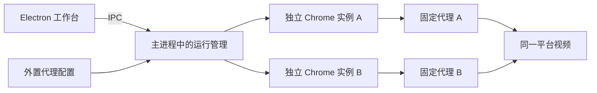

# 播放验证工作台实施方案

版本 1.1 · 2026 年 11 月 16 日 · Windows / macOS

建设一个本地桌面客户端：输入同一个平台视频链接，启动多个独立浏览器实例，每路绑定不同的公网代理出口，并发完成一次播放，直接展示各路结果。主要测试抖音视频，只验证不同 IP 下的播放，不限制出口国家或地区。采用 Electron、TypeScript 和 Playwright，复用现有界面，以现有 Webshare IP 池作为首批待验证出口，不建设服务端。

实施以可运行、易维护为先。使用有权测试的视频链接，先验证真实平台、真实出口和真实播放，再完善界面与交付包。

## 一 目标与实施范围

### 目标

- Windows 和 macOS 使用同一套客户端代码。
- 同一轮输入一个链接，默认 4 路并发，每路完整播放一次；保留 2、3 路供小规模检查。
- 每路有独立浏览器主进程、独立 Cookie 和存储环境、固定代理节点。
- 展示实际出口 IP、播放状态、媒体进度及失败原因。
- 允许查看对应浏览器、停止任务及手动导出本轮结果。

“任意平台链接”作为统一输入目标；播放支持按实际兼容性验收。首版只实现抖音视频详情页及通用 HTML5 视频页，小红书等平台在有实际需求时再增加适配。不能把“可以输入链接”表述为“所有平台均已支持”。直播、图文内容、只能在原生 App 打开的内容不纳入首版完播验收。

### 与客户原资料的关系

| 项目 | 本次实施口径 |
| --- | --- |
| 原资料中的 macOS Electron | 扩展为 Windows 和 macOS 客户端。 |
| 原资料允许顺序验证 | 必须真正并发；顺序切换 IP 不满足本次目标。 |
| HTML 中固定 6 秒的模拟播放 | 替换为实际浏览器和播放器状态；模拟 PID、IP、进度不能用于运行结果。 |
| 每路各播放一次 | 保留；不循环刷任务，不在失败后自动重新播放。 |
| 原请求审计与服务端对账 | 首版只保留运行必需的状态、错误和结果；不实现全量请求审计、TLS 指纹采集及第三方服务端日志对账。 |
| 不同 IP 的判定依据 | 原 PRD 要求关联到同一次媒体请求的服务端来源 IP；本方案拟改为播放前的浏览器出口检查，加开发阶段实际媒体连接检查。这一验收口径变更待客户确认。 |
| 原资料中的本机自检结论 | 只作为背景；实现源码和引用的日志未包含在现有交付中，本次仍需重新验证真实功能。 |

首版不增加软件用户体系、权限、审批、审计留痕、云同步、后台管理、账号池、自动登录、自动更新或分布式任务系统。播放状态和结果用于回答“这一路是否完成”，不另建历史记录平台。

需客户确认的具体口径为：“接受客户端出口检查及播放结果作为第三方平台测试的验收依据，不要求提供该平台服务端对同一次媒体请求的来源 IP 记录。”本项目未取得抖音服务端日志；客户若坚持原标准，需提供可取得服务端记录的自有或受控测试服务。确认前，第三方平台结果只称“客户端测试结果”，不宣称满足原 PRD 的服务端验收标准。

## 二 技术架构

### 技术选型

| 部分 | 选择 | 用途 |
| --- | --- | --- |
| 桌面外壳 | Electron | 工作台窗口、文件选择、应用生命周期和跨平台打包。 |
| 应用代码 | TypeScript | 界面与主进程共用少量数据类型。 |
| 界面 | 现有 HTML / CSS 加普通 TypeScript | 保留原型布局，不为两个页面引入额外前端框架或状态管理库。 |
| 浏览器控制 | Playwright Core | 启动浏览器、设置代理、操作页面和读取媒体状态。 |
| 视频浏览器 | 本机 Google Chrome 稳定版 | 两个平台使用同一浏览器类型，独立启动测试实例。 |
| 构建打包 | tsc 加 Electron Forge 基础模板 | 分别编译主进程和界面代码，生成 ZIP 交付包。 |
| 配置与结果 | 外置文本配置、内存状态、手动 JSON 导出 | 无数据库，无常驻后端。 |

首版复用本机 Chrome，交付包不捆绑另一套视频浏览器。首次启动检查 Chrome 是否存在；未安装时给出安装提示，不自动修改用户的浏览器。测试实例使用临时独立环境，不接管日常使用的 Chrome 窗口。正式 Chrome 与普通 Chromium 的媒体编解码支持存在差异，视频场景优先验证正式 Chrome。[Playwright 浏览器说明](https://playwright.dev/docs/browsers#google-chrome--microsoft-edge)

不引入 Vite 或其他代码打包器。`tsc` 编译 TypeScript，普通文件复制脚本处理 HTML 和 CSS。`playwright-core` 放在生产依赖中，保留完整包目录与随包资源，由 Forge 基础打包流程带入；不把它内联成单个脚本，也不为复制依赖另写插件。阶段 2 即验证打包产物，而非仅验证开发模式。

启动时显示实际 Chrome 版本，交付说明列出已验证的 Chrome 和 `playwright-core` 版本组合。本机 Chrome 更新后如出现兼容问题，先复现并升级 `playwright-core`、重新验证和打包；不开发浏览器版本管理或自动更新系统。

### 运行结构



运行管理直接放在 Electron 主进程内，使用异步调用管理浏览器。每一路启动一个独立 Chrome 实例；不使用同一个浏览器里的多个标签页冒充独立进程，也不再给每一路额外增加一个自建 Node 工作进程。

通过 `chromium.launchServer()` 启动实例，设置 `channel: 'chrome'`、有界面的运行方式及本路 HTTP 代理认证；通过同版本 Playwright 的 `connect()` 控制实例。这里的 BrowserServer 只是本机浏览器控制连接，使用回环地址，不是需要部署的业务服务。[Playwright BrowserType](https://playwright.dev/docs/api/class-browsertype#browser-type-launch-server)

实际 PID 从 `browserServer.process().pid` 获取。每个实例新建一个独立 BrowserContext 和目标页面；结束时关闭该实例。停止超时才使用该实例的 `kill()`，不按进程名批量结束用户的 Chrome。[Playwright BrowserServer](https://playwright.dev/docs/api/class-browserserver)

### 代码组织

实现时保持单一工程，按职责拆分普通文件即可：

```text
src/
  main/
    index.ts          窗口、IPC、应用退出
    run.ts            当前一轮及各路状态、启动和停止
    browser.ts        实例启动、代理绑定、预览和关闭
    proxies.ts        配置读取、节点选择和出口检查
    playback.ts       共享媒体观察与完播判断
    platforms/
      generic.ts      通用 HTML5 视频定位与操作
      douyin.ts       抖音页面所需的实际差异
  preload.ts          少量工作台调用入口
  renderer/           原型界面与展示逻辑
  types.ts            运行配置和结果类型
```

平台文件使用普通导出函数和按域名分支选择，不设计插件注册中心、抽象基类、动态脚本市场或通用工作流引擎。播放观察和结果判断只实现一份，平台代码仅处理确实不同的页面行为。

## 三 Webshare 配置与出口分配

### 外置配置文件

使用 `proxies.private.txt`，沿用现有格式，一行一个节点：

```text
192.0.2.11:8000:example_user:example_password
192.0.2.12:8000:example_user:example_password
```

以上均为虚构示例，不能用于联网。两端统一通过“选择代理文件”读取用户选定位置的真实文件，保存其绝对路径，每次运行重新读取；文件被移动或删除时提示重新选择。不依赖程序所在目录、工作目录或 `.app` 的同级目录，也不把密码复制进另一套配置或凭据管理系统。

配置解析只检查本功能需要的内容：忽略空行，校验字段和端口，按 IP 与端口去重；错误提示指出行号。运行中修改文件不改变当前连接，新一轮才使用新配置。仓库提供 `proxies.example.txt`，真实的 `*.private.txt` 不提交 Git。

现有材料包含 100 个不同地址的 Webshare 节点，复用说明标注为共享静态机房 IP、Direct Connection。该连接方式适合固定指定节点，不要求每个请求更换 IP。[Webshare 连接方式](https://help.webshare.io/en/articles/8375305-understanding-proxy-connection-types-direct-rotating-and-backbone)

这些节点与其他项目共用。本项目日常按 4 路并发使用，从现有池中筛选约 10 个播放抖音较快的可用节点，作为包含常用节点与备用节点的配置子集；长期使用前由使用方确认分配。软件不接管其他项目，不建设跨项目节点注册或占用管理服务。

筛选以代表性抖音视频的媒体就绪时间、实际播放耗时、缓冲及是否播到结尾为依据，不能只看出口查询、首页响应或代理延迟。先小批量实播筛选，再用其中 4 个不同出口验证并行播放。测试结果只代表当时网络与样例，后续遇到变慢或失效，由使用方调整文件顺序或替换节点；首版不增加自动测速、定时探活、动态评分或自动轮换系统。

### 出口选择

抖音与 TikTok 是两个独立产品，分别面向中国市场和全球市场；使用美国出口访问抖音链接，不会因此变成测试 TikTok。[字节跳动产品介绍](https://www.bytedance.com/products-services)

本项目只验证“不同公网 IP 能否并发完整播放同一视频”。美国等海外节点与大陆节点采用相同验收条件：实际出口不同、目标内容可访问、播放完整且确有并发。不增加地域筛选、IP 地理查询或国内出口要求。

首先验证客户实际使用网络到代理节点、再到抖音页面及媒体的完整路径。当前节点列表本身不能证明这些路径可用；现有 Webshare 节点若不满足目标，只替换外置配置中的节点，沿用同一套 HTTP 代理接入，不为供应商差异建设代理平台。

开发先验证抖音的实际路径；不以海外节点能打开首页或能返回出口 IP，推断它能播放客户指定的视频。

### 中国大陆节点备选

境外节点并非都不能流畅播放，但跨境路径可能增加延迟与波动；只凭所在国家不能确定节点质量。[Cloudflare 跨境网络说明](https://developers.cloudflare.com/china-network/)

若客户端主要在中国大陆使用，优先试用少量大陆固定 HTTP 代理，与现有 Webshare 节点比较；先取得 2–4 个不同出口，在客户实际机器和网络上测试同一批视频，再决定是否扩至约 10 个。客户端若运行在境外，到大陆代理仍有跨境链路，不能保证仅换成大陆 IP 就会变快。地域作为节点选型因素，不新增产品地域限制或自动地域筛选。

节点须支持 HTTPS CONNECT 和现有认证方式，整次播放保持同一出口；关注视频传输带宽与流量额度，避免使用播放中会到期或自动轮换的短效节点。可将快代理国内静态型、小象静态代理等现成服务作为试用候选；供应商产品说明不等于已通过本项目实测，采购前确认具体套餐支持目标视频访问。[快代理静态型规格](https://wxapp.kuaidaili.com/doc/product/kps_paytype/)、[小象静态代理](https://www.xiaoxiangdaili.com/ip-static)

更换来源只替换外置配置，并核验出口诊断地址可达，无需更改核心播放流程。已有国内云主机和不同公网出口时也可复用其 HTTP 代理；首版不为此新建云主机管理、多出口路由或供应商调度系统。

### 分配规则

1. 默认并发数 N 为 4，程序按配置文件顺序选择前 N 个不重复节点，界面显示本轮分配。约 10 个节点无需全部启动，剩余节点留作备用；需要换节点时调整文件后重新开始一轮。
2. 每路在浏览器启动时绑定一个节点及认证信息；整次播放保持不变，不使用全局系统代理切换。
3. 使用该浏览器实际打开出口诊断地址，例如 Webshare 的 `https://ipv4.webshare.io/`，获取并比较公网出口。不能用主进程直接发出的请求代替。
4. 任一路不可连接、认证失败、出口重复或节点不足时，显示原因，本轮不进入播放；不静默降低并发数或切换为直连。
5. 静态 Direct 节点在整轮保持固定，不在结束时重复查询出口；若节点断开或认证失效，该路按连接或播放失败处理。

页面、短链跳转、嵌套页面和媒体请求均应使用所属实例的代理。代理失败后不得回退到本机出口。开发阶段使用实际媒体请求的 `response.serverAddr()` 检查连接地址和端口是否对应所配置的 HTTP 代理，并验证断开代理后播放不能继续通过新的直连请求取流。该 API 可能返回空值，不把缺失值或缓存响应当作接线成功；它也不等于平台服务端观察到的来源 IP。[Playwright Response](https://playwright.dev/docs/api/class-response#response-server-addr)

阶段 1 同时检查是否创建 WebRTC 连接，并查看实际连接和媒体收发统计；仅创建 `RTCPeerConnection` 不足以证明视频使用了点对点传输。若发现非代理 UDP 连接，给测试实例加入 `--force-webrtc-ip-handling-policy=disable_non_proxied_udp` 并重新检查实际连接。参数是否生效以当前 Chrome 实测为准；若仍有绕过代理的媒体流量，该配置不能通过本项目验证。只处理播放路径，不扩展成通用网络防护功能。

IP 诊断说明的是该浏览器访问诊断服务时的出口，不等于已经取得抖音对同一次媒体请求的服务端观测。产品中使用“出口检查”这一名称，不显示虚构的“平台接入层 IP”。

100 个节点不代表本机可以同时播放 100 路，也不代表套餐有 100 路视频带宽。代理供应商的并发通常按请求计算，而且额度由账号内项目共享；浏览器路数需结合实际连接量、带宽和本机资源测定。[Webshare 并发说明](https://help.webshare.io/en/articles/8375281-what-is-concurrency)

## 四 视频平台与登录处理

### 链接和页面适配

输入保留完整链接的查询参数和片段，避免破坏分享链接或访问所需参数。短链接由各路已绑定代理的浏览器自行打开和跟随跳转，不先在本机直连解析，也不依赖额外的视频解析服务。

平台适配负责定位链接对应的主视频、确认内容标识、处理正常播放按钮，并识别登录要求、内容不存在、访问受限等可见状态。通用逻辑只在目标视频可明确识别时工作；页面包含多个候选视频且无法区分时，报告“无法确定目标视频”，不默认播放第一个元素。

优先在平台原页面中播放，由平台自身播放器处理媒体格式和分段加载。首版不增加视频下载、转码、媒体转发服务器或私有接口逆向。

### 登录策略

默认各路以独立的未登录会话打开链接，不预设需要 N 个平台账号。抖音官方说明包含未登录浏览场景，但不能据此保证任意视频在任意出口均可免登录播放。[抖音隐私政策](https://www.douyin.com/draft/douyin_agreement/douyin_agreement_privacy.html?id=6773901168964798477)

- 未登录仍能播放：继续准备本轮测试；单独出现“Login to Douyin”等登录提示不等于播放失败，不仅凭提示文字暂停任务。
- 登录或人工验证确实阻止目标播放：该路显示“待操作”，用户在该路实际浏览器中处理后点击继续。
- 用户不处理或页面仍不能访问：该路不能作为可播放路线进入正式运行；允许停止本轮并更换配置或链接。

独立会话不等于必须使用不同账号。每路需要各自有效的登录状态；同一账号能否在多个实例同时使用，取决于平台实际行为，首版不作保证，也不自动复制 Cookie。手动登录仅在当前实例内有效；首版不增加跨轮登录状态保存、账号密码配置或账号管理功能。

## 五 一轮运行的流程

1. **读取配置**：确认链接、并发数、Chrome 和代理文件。默认四路，保留原型的 2、3、4 路选项。
2. **创建实例**：为各路分配节点，启动独立浏览器并取得实际 PID。
3. **检查出口**：通过各自浏览器检查出口，确认 N 个公网地址均不同。
4. **准备页面**：各路打开同一链接，识别同一目标内容，绑定媒体观察，处理必要的人工操作，进入待播放状态。
5. **统一开始**：全部路线准备就绪后同时发出播放操作。加载阶段的自动播放须由平台适配暂停，开始前将目标定位到起点；正式开始后不再自动重置或重新加载。
6. **并发观察**：实时更新进度、缓冲和错误。某一路播放失败不会阻止其他路线完成，但本轮不能显示全部通过。
7. **完成收尾**：各路第一次完成后停止继续播放并关闭该路浏览器。结果留在本轮界面，用户可手动导出。

“并发”按各路播放起止时刻是否重叠判断，不要求逐帧同步：`max(各路首次实际推进时刻) < min(各路结束时刻)`。时刻在页面事件发生时采集并转换到可比较的时间基准，不使用界面每秒刷新时的接收时间。缓冲不另行扣除，因此这个口径表示播放任务时间重叠，不表示每一瞬间所有路线都在解码。无重叠时显示“各路已完成，并发未通过”。

全局停止会取消仍在启动、加载或播放中的路线，并关闭已经创建的实例；正在创建的实例返回后也必须被关闭。开始新一轮前先等上一轮释放完毕，避免遗留播放。重试由用户显式启动新一轮，不在后台自动补播。

## 六 播放观察与结果判断

### 观察方式

在页面加载早期安装媒体事件观察，覆盖动态插入的目标视频和相关 frame。关键事件在捕获阶段立即记录媒体状态，避免平台在结束事件处理器中回零后才读到位置；首个有效结束事件之后的自动重播不计入本轮。选定内容后绑定它的播放生命周期，不把推荐视频、广告、后续自动切换的内容拼入同一次结果。

读取 `currentTime`、`duration`、`currentSrc`、`paused`、`playbackRate` 和媒体错误，监听媒体事件；不读取 `played`，不自行累计播放区间。界面进度约每秒更新一次，判定使用页面直接采集的事件和当时的媒体状态。

每路默认静音，启动浏览器时设置 `--mute-audio`，选中预览也不自动解除静音；播放速度保持 1。准备阶段暂停目标并设置 `currentTime = 0`，等待由这次操作产生的 `seeked` 完成，再建立正式观察起点并开始播放。设置起点的事件不能混入正式运行。

### 完播判定

一条路线确认完播，须同时满足：

- 目标内容正确，时长有效且有限，正式开始时位于起点附近，之后观察到实际推进。
- 正式运行没有跳转事件，播放速度始终为 1。
- 同一目标媒体元素、视频来源和时长保持稳定；这里的来源指播放器的 `currentSrc`，不是每个媒体分片的请求地址。
- 收到目标媒体的 `ended`，最终位置与时长相符；或符合下述已验证的首轮循环结束规则。

容差仅用于起点和终点的媒体位置比较，初值为 `min(0.25 秒, 视频时长的 1%)`。不比较相邻进度事件的间隔，不从事件采样间隙推断跳播；`timeupdate` 频率会随负载变化，并非精确时钟。[MDN timeupdate](https://developer.mozilla.org/en-US/docs/Web/API/HTMLMediaElement/timeupdate_event)

原生循环可能不触发 `ended`。优先关闭所选媒体的原生循环，以 `ended` 结束；无法关闭时，只接受阶段 1 已验证的“到达末端后自动回到起点”的事件序列，并立即停止第二轮。回零本身不是完播证据。循环边界若带有 `seeking`，只能作为已识别循环序列的终止事件，不能普遍忽略所有跳转；无法区分循环、脚本重置或人工跳转时标为未确认。[MDN ended](https://developer.mozilla.org/en-US/docs/Web/API/HTMLMediaElement/ended_event)

判定逻辑写成“输入事件序列，输出结果”的纯函数，与浏览器操作分离。阶段 1 保存少量去除凭据的真实事件序列作为开发测试数据，覆盖正常结束、循环、跳转、变速、换源、超时与观察中断。缺少起点或监听中断时不能仅凭最后的结束事件判为通过；这项开发验证不增加产品历史留痕功能。

### 超时与异常

先使用少量明确的默认值：出口检查 15 秒、页面及媒体就绪 60 秒、播放无进展 30 秒。播放总时限为目标时长的两倍加 60 秒。上述值集中定义，真实平台测试发现合理需要时再修改，不做复杂的超时配置页面。

准备阶段的人工操作不计入媒体加载超时，界面保持“待操作”并允许停止。准备条件失败时整轮不进入正式播放；正式播放开始后的网络断开、页面关闭、播放器错误或超时，只终止受影响路线并显示具体原因。

单路结果使用“完播”“失败”“已停止”“未确认”。出口检查和播放结果分别展示，防止把 IP 查询成功误当成播放成功。本轮只有在 N 路均完播、播放前检查的出口互不重复、内容一致、播放起止区间重叠时，才显示“客户端测试通过”。

这一结论表示客户端验证通过，不代表平台后台增加了播放量，也不代表已取得平台服务端的 IP 或完播确认。

## 七 工作台界面与数据

### 界面

沿用原型的链接输入、并发数量和进程卡片，增加代理文件选择及本轮节点列表。卡片显示真实 PID、出口、状态和播放进度。截图预览为可选项，只截当前选中的一路，约每秒刷新一次，单次超时 2 秒且不叠加未完成请求；超时显示“画面暂未更新”，不影响播放判断。

首版不嵌入外部浏览器窗口，不做视频流转发。需要点击、登录或人工处理时，使用该路原生 Chrome 窗口；工作台提供定位该页面的入口。切换预览只切换观察对象，不新建页面或重新播放。完成后显示最后一帧和结果即可。

启动时根据可用屏幕区域，通过 `--window-position` 和 `--window-size` 将各路窗口平铺，保持可见，不主动最小化。界面提示“播放期间不要最小化测试窗口”。窗口被最小化或页面转为隐藏后是否暂停由平台实测确认，不假设浏览器后台参数能阻止平台自行暂停；因此停止推进仍按超时处理。

原“请求审计”页调整为“本轮结果”：列出各路播放结果、出口检查、起止时间和错误原因，不保留模拟的浏览器、接入层、应用层三方对账。

### 数据与文件

运行管理只维护当前一轮的 `Run` 和各路 `Lane`，使用普通对象与数组：

| 数据 | 必要内容 |
| --- | --- |
| 本轮 | 运行编号、输入链接、并发数、起止时间、并发是否成立、汇总结果。 |
| 每路 | 路线编号、真实 PID、Chrome 版本、节点地址、播放前出口、内容标识、时长、最终位置、起止时刻、结束方式、状态和错误。 |
| 本地设置 | 代理文件路径、上次使用的并发数等少量选项。 |

运行状态保存在内存。用户点击导出才生成本轮 JSON；新一轮替换界面中的旧结果，不增加历史查询、数据库、持续录像、全量网络抓包或自动截图归档。配置中的代理密码不进入结果文件。

IPC 只提供本任务需要的几项能力：选择文件、开始、停止、继续人工处理后的准备、查看指定路线、导出结果及接收状态更新。

## 八 开发顺序与验证

| 阶段 | 实施内容 | 完成标准 |
| --- | --- | --- |
| 1 真实路径验证 | 在客户实际使用网络中，用最小开发脚本先验证两路，再筛选约 10 个候选节点并验证四路独立 Chrome 同时播放有权测试的抖音样例。 | 实测登录提示与实际播放、出口与媒体连接、WebRTC 是否有实际传输；比较节点加载和播放速度，保存关键媒体事件作为判定测试数据。 |
| 2 核心流程及打包冒烟 | 实现配置、实例管理、统一开始、事件判定、停止和异常收尾，并生成双平台最小交付包。 | 两路流程与异常判断成立；Windows、macOS 均从打包产物成功启动 Chrome，经代理打开页面，确认运行依赖和资源齐全。 |
| 3 工作台接入 | 将原型模拟数据替换为实际运行状态，完成预览、人工操作入口和本轮结果。 | UI 与实际实例一致；切换预览不增加播放；停止和新一轮不会遗留旧实例。 |
| 4 双平台交付 | 完成 Windows ZIP 与 macOS 应用包，检查文件选择、已验证的浏览器版本和使用说明。 | 在实际 Windows、macOS 设备上从解压产物完成四路播放、停止、退出和再次启动。 |

阶段 1 可从两个节点开始验证；最终需要四个不同且可播放的出口，并以约 10 个较快节点作为日常配置目标。若现有池筛不出足够节点，如实报告实际数量，按下表决定补充或替换来源，不为凑数将不可用节点列为备用。如实际样例必须登录，使用方在对应窗口完成登录；不把准备一批账号作为开发的默认前提。

### 阶段 1 不通过时的处理

| 实际问题 | 下一步及决定方 |
| --- | --- |
| 代理认证或连接失败 | 开发人员确认配置和故障层；节点提供方修正凭据或更换可用节点，再验证同一目标。 |
| 页面出现登录提示或验证码 | 先确认是否真的阻止播放；可正常关闭的提示使用页面关闭按钮。必须人工处理时，由使用方操作；客户决定是否接受这种使用方式。 |
| 节点普遍无法访问、媒体加载失败或速度不足 | 开发人员提供失败类型与样例；用户选择另一批节点或供应商，再做小规模验证，不建设自动换 IP 重试系统。 |
| 正常页面操作仍无法完整播放、可靠观察，或存在无法消除的直连媒体路径 | 如实报告不支持的场景；客户决定更换测试内容、接受人工播放验证或调整目标，不把页面打开冒充播放通过。 |

仅在某一技术路径实测成立后推进完整界面；上述问题不会自动变成账号系统、规避验证或大规模代理采购需求。

### 定向验收

- **本机样片**：本机页面不走代理，验证自然结束、缓冲、跳转、变速、循环及媒体替换；不为此搭建公网测试服务。
- **真实平台**：抖音用代表性视频验证分享链接、目标识别、登录分支、首轮结束和不同出口下的可播放性，并检查真实媒体连接。本机样片通过不能代替平台验收。
- **隔离与并发**：核对不同浏览器主进程 PID，各自站点状态不共享；窗口保持可见，首次推进与结束事件构成的各路时间区间重叠。
- **失败与关闭**：在启动中、等待人工操作、播放中分别停止；验证连接错误不会变为直连，关闭应用后没有本次任务遗留的播放实例。
- **容量**：以四路并发作为日常使用和交付验收标准，记录设备和视频条件；约 10 个节点是常用与备用配置的总量，不代表同时启动 10 路。首版不承诺百路播放，也不提前建设集群。

自动化检查集中于配置解析、节点分配、完播判断和停止竞态；浏览器与平台行为做小规模端到端验证。不为文档、界面文案或简单数据映射另建测试框架。

## 九 打包与交付

目标产物为 Windows x64 免安装 ZIP、macOS Apple Silicon 和 Intel 对应的应用 ZIP。Windows 解压运行，不使用 Squirrel 安装器；macOS 解压后将 `.app` 移至应用程序目录。各目标架构分别构建与验证，共用业务代码。操作系统最低版本在首次构建时按选定 Electron、Playwright 和 Chrome 的共同支持范围确定，并写入使用说明。

使用 Electron Forge 基础打包流程和 `@electron-forge/maker-zip`，保留运行依赖，不编写自定义安装器或 Vite 依赖复制补丁。[Forge ZIP](https://www.electronforge.io/config/makers/zip)

客户运行时不需要安装 Node.js 或 Python，但需要本机 Chrome 和可用的代理配置。交付包括客户端产物、源码、虚构配置示例及简短使用说明；发布签名、公证按实际分发方式处理，不扩展为自动更新或软件发布平台。

首版交付的判断标准是：用户在 Windows 或 macOS 上选择配置、输入已验收平台的视频链接后，能真实启动多路不同出口的并发播放，并看到准确结果及可处理的失败原因。
