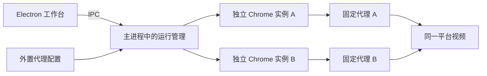

# 播放验证工作台实施方案

版本 1.0 · 2026 年 11 月 16 日 · Windows / macOS

建设一个本地桌面客户端：输入同一个平台视频链接，启动多个独立浏览器实例，每路绑定不同的公网代理出口，并发完成一次播放，直接展示各路结果。主要使用场景为中国大陆的抖音视频。采用 Electron、TypeScript 和 Playwright，复用现有界面，以现有 Webshare IP 池作为首批待验证出口，不建设服务端。

实施以可运行、易维护为先。先验证真实平台、真实出口和真实播放，再完善界面与安装包。

## 一 目标与实施范围

### 目标

- Windows 和 macOS 使用同一套客户端代码。
- 同一轮输入一个链接，配置并发路数，每路完整播放一次。
- 每路有独立浏览器主进程、独立 Cookie 和存储环境、固定代理节点。
- 展示实际出口 IP、播放状态、媒体进度及失败原因。
- 允许查看对应浏览器、停止任务及手动导出本轮结果。

“任意平台链接”作为统一输入目标；播放支持按实际兼容性验收。首批实现抖音、小红书视频详情页及通用 HTML5 视频页，其他平台先尝试通用播放逻辑，需要特殊操作时再针对该平台增加适配。不能把“可以输入链接”表述为“所有平台均已支持”。直播、图文内容、只能在原生 App 打开的内容不纳入首版完播验收。

### 与客户原资料的关系

| 项目 | 本次实施口径 |
| --- | --- |
| 原资料中的 macOS Electron | 扩展为 Windows 和 macOS 客户端。 |
| 原资料允许顺序验证 | 必须真正并发；顺序切换 IP 不满足本次目标。 |
| HTML 中固定 6 秒的模拟播放 | 替换为实际浏览器和播放器状态；模拟 PID、IP、进度不能用于运行结果。 |
| 每路各播放一次 | 保留；不循环刷任务，不在失败后自动重新播放。 |
| 原请求审计与服务端对账 | 首版只保留运行必需的状态、错误和结果；不实现全量请求审计、TLS 指纹采集及第三方服务端日志对账。 |
| 原资料中的本机自检结论 | 只作为背景；实现源码和引用的日志未包含在现有交付中，本次仍需重新验证真实功能。 |

首版不增加软件用户体系、权限、审批、审计留痕、云同步、后台管理、账号池、自动登录、自动更新或分布式任务系统。播放状态和结果用于回答“这一路是否完成”，不另建历史记录平台。

## 二 技术架构

### 技术选型

| 部分 | 选择 | 用途 |
| --- | --- | --- |
| 桌面外壳 | Electron | 工作台窗口、文件选择、应用生命周期和跨平台打包。 |
| 应用代码 | TypeScript | 界面与主进程共用少量数据类型。 |
| 界面 | 现有 HTML / CSS 加普通 TypeScript | 保留原型布局，不为两个页面引入额外前端框架或状态管理库。 |
| 浏览器控制 | Playwright Core | 启动浏览器、设置代理、操作页面和读取媒体状态。 |
| 视频浏览器 | 本机 Google Chrome 稳定版 | 两个平台使用同一浏览器类型，独立启动测试实例。 |
| 构建打包 | Electron Forge 加 Vite | 编译 TypeScript，生成 Windows 和 macOS 安装产物。 |
| 配置与结果 | 外置文本配置、内存状态、手动 JSON 导出 | 无数据库，无常驻后端。 |

首版复用本机 Chrome，安装包不捆绑另一套视频浏览器。首次启动检查 Chrome 是否存在；未安装时给出安装提示，不自动修改用户的浏览器。测试实例使用临时独立环境，不接管日常使用的 Chrome 窗口。正式 Chrome 与普通 Chromium 的媒体编解码支持存在差异，视频场景优先验证正式 Chrome。[Playwright 浏览器说明](https://playwright.dev/docs/browsers#google-chrome--microsoft-edge)

### 运行结构



运行管理直接放在 Electron 主进程内，使用异步调用管理浏览器。每一路启动一个独立 Chrome 实例；不使用同一个浏览器里的多个标签页冒充独立进程，也不再给每一路额外增加一个自建 Node 工作进程。

通过 `chromium.launchServer()` 启动实例，设置 `channel: 'chrome'`、有界面的运行方式及本路 HTTP 代理认证；通过同版本 Playwright 的 `connect()` 控制实例。这里的 BrowserServer 只是本机浏览器控制连接，使用回环地址，不是需要部署的业务服务。[Playwright BrowserType](https://playwright.dev/docs/api/class-browsertype#browser-type-launch-server)

实际 PID 从 `browserServer.process().pid` 获取。每个实例新建一个独立 BrowserContext 和目标页面；结束时关闭该实例。停止超时才使用该实例的 `kill()`，不按进程名批量结束用户的 Chrome。[Playwright BrowserServer](https://playwright.dev/docs/api/class-browserserver)

### 代码组织

实现时保持单一工程，按职责拆分普通文件即可：

```text
src/
  main/
    index.ts          窗口、IPC、应用退出
    run.ts            当前一轮及各路状态、启动和停止
    browser.ts        实例启动、代理绑定、预览和关闭
    proxies.ts        配置读取、节点选择和出口检查
    playback.ts       共享媒体观察与完播判断
    platforms/
      generic.ts      通用 HTML5 视频定位与操作
      douyin.ts       抖音页面所需的实际差异
      xiaohongshu.ts  小红书页面所需的实际差异
  preload.ts          少量工作台调用入口
  renderer/           原型界面与展示逻辑
  types.ts            运行配置和结果类型
```

平台文件使用普通导出函数和按域名分支选择，不设计插件注册中心、抽象基类、动态脚本市场或通用工作流引擎。播放观察和结果判断只实现一份，平台代码仅处理确实不同的页面行为。

## 三 Webshare 配置与出口分配

### 外置配置文件

使用 `proxies.private.txt`，沿用现有格式，一行一个节点：

```text
192.0.2.11:8000:example_user:example_password
192.0.2.12:8000:example_user:example_password
```

以上均为虚构示例，不能用于联网。真实文件可放在 Windows 软件所在目录旁边；macOS 放在 `.app` 包外的同级目录。两端均提供“选择代理文件”，适用于安装目录不可写或文件放在其他位置的情况。首次选择后只保存文件路径，每次运行重新读取；不把密码复制进另一套配置或凭据管理系统。

配置解析只检查本功能需要的内容：忽略空行，校验字段和端口，按 IP 与端口去重；错误提示指出行号。运行中修改文件不改变当前连接，新一轮才使用新配置。仓库提供 `proxies.example.txt`，真实的 `*.private.txt` 不提交 Git。

现有材料包含 100 个不同地址的 Webshare 节点，复用说明标注为共享静态机房 IP、Direct Connection。该连接方式适合固定指定节点，不要求每个请求更换 IP。[Webshare 连接方式](https://help.webshare.io/en/articles/8375305-understanding-proxy-connection-types-direct-rotating-and-backbone)

这些节点与其他项目共用。实施前由使用方提供可分配给本项目的节点子集，放入该文件；软件不接管其他项目，不建设跨项目节点注册或占用管理服务。

### 出口地域与大陆使用场景

抖音与 TikTok 是两个独立产品，分别面向中国市场和全球市场；使用美国出口访问抖音链接，不会因此变成测试 TikTok。[字节跳动产品介绍](https://www.bytedance.com/products-services)

本项目首先验证客户实际使用网络到代理节点、再到抖音页面及媒体的完整路径。当前节点列表不能证明这些路径可用，也没有给出本项目所需的地域验收结论。

- 若目标仅为“不同 IP 下能否完整播放”，使用实测通过的不同出口，不额外增加地域限制。
- 若目标包含“中国大陆用户的访问情况”，使用不同的大陆出口验收；海外出口即使能够播放，也不能代替这一结果。
- 现有 Webshare 节点若不满足目标，只替换外置配置中的节点，沿用同一套 HTTP 代理接入，不为供应商差异建设代理平台。

开发先验证抖音的实际路径，再推进小红书等适配；不以海外节点能打开首页或能返回出口 IP，推断它能播放客户指定的视频。

### 分配规则

1. 用户设定并发数 N，程序从本项目配置中选择 N 个不重复节点，界面显示本轮分配。
2. 每路在浏览器启动时绑定一个节点及认证信息；整次播放保持不变，不使用全局系统代理切换。
3. 使用该浏览器实际打开出口诊断地址，例如 Webshare 的 `https://ipv4.webshare.io/`，获取并比较公网出口。不能用主进程直接发出的请求代替。
4. 任一路不可连接、认证失败、出口重复或节点不足时，显示原因，本轮不进入播放；不静默降低并发数或切换为直连。
5. 结束时在仍使用同一代理的实例中再次检查出口。若地址改变或无法确认，保留播放结果，出口验证单独标为异常或未确认。

页面、短链跳转、嵌套页面和媒体请求均应使用所属实例的代理。代理失败后不得回退到本机出口。开发验证需要覆盖跨域媒体、重定向和实际播放器使用的请求路径，不能只测一个 IP 查询接口。

IP 诊断说明的是该浏览器访问诊断服务时的出口，不等于已经取得抖音或小红书对同一次媒体请求的服务端观测。产品中使用“出口检查”这一名称，不显示虚构的“平台接入层 IP”。

100 个节点不代表本机可以同时播放 100 路，也不代表套餐有 100 路视频带宽。代理供应商的并发通常按请求计算，而且额度由账号内项目共享；浏览器路数需结合实际连接量、带宽和本机资源测定。[Webshare 并发说明](https://help.webshare.io/en/articles/8375281-what-is-concurrency)

## 四 视频平台与登录处理

### 链接和页面适配

输入保留完整链接的查询参数和片段，避免破坏分享链接或访问所需参数。短链接由各路已绑定代理的浏览器自行打开和跟随跳转，不先在本机直连解析，也不依赖额外的视频解析服务。

平台适配负责定位链接对应的主视频、确认内容标识、处理正常播放按钮，并识别登录要求、内容不存在、访问受限等可见状态。通用逻辑只在目标视频可明确识别时工作；页面包含多个候选视频且无法区分时，报告“无法确定目标视频”，不默认播放第一个元素。

优先在平台原页面中播放，由平台自身播放器处理媒体格式和分段加载。首版不增加视频下载、转码、媒体转发服务器或私有接口逆向。

### 登录策略

默认各路以独立的未登录会话打开链接，不预设需要 N 个平台账号。抖音官方说明包含未登录浏览场景，但不能据此保证任意视频在任意出口均可免登录播放。[抖音隐私政策](https://www.douyin.com/draft/douyin_agreement/douyin_agreement_privacy.html?id=6773901168964798477)

- 无需登录且能播放：继续准备本轮测试。
- 页面要求登录或人工验证：该路显示“待操作”，用户在该路实际浏览器中处理后点击继续。
- 用户不处理或页面仍不能访问：该路不能作为可播放路线进入正式运行；允许停止本轮并更换配置或链接。

独立会话不等于必须使用不同账号。每路需要各自有效的登录状态；同一账号能否在多个实例同时使用，取决于平台实际行为，首版不作保证，也不自动复制 Cookie。手动登录仅在当前实例内有效；首版不增加跨轮登录状态保存、账号密码配置或账号管理功能。

## 五 一轮运行的流程

1. **读取配置**：确认链接、并发数、Chrome 和代理文件。默认两路，初始界面保留原型的 2、3、4 路选项。
2. **创建实例**：为各路分配节点，启动独立浏览器并取得实际 PID。
3. **检查出口**：通过各自浏览器检查出口，确认 N 个公网地址均不同。
4. **准备页面**：各路打开同一链接，识别同一目标内容，绑定媒体观察，处理必要的人工操作，进入待播放状态。
5. **统一开始**：全部路线准备就绪后同时发出播放操作。加载阶段的自动播放须由平台适配暂停，开始前将目标定位到起点；正式开始后不再自动重置或重新加载。
6. **并发观察**：实时更新进度、缓冲和错误。某一路播放失败不会阻止其他路线完成，但本轮不能显示全部通过。
7. **完成收尾**：各路第一次完成后停止继续播放，复查出口并关闭该路浏览器。结果留在本轮界面，用户可手动导出。

“并发”要求所有请求路线存在共同的实际播放时间区间，不要求逐帧同步。用各路媒体时间确实推进的时间段计算交集，缓冲、暂停及等待操作不算正在播放。全部路线虽然分别完成、但没有共同播放区间时，显示“各路已完成，并发未通过”。

全局停止会取消仍在启动、加载或播放中的路线，并关闭已经创建的实例；正在创建的实例返回后也必须被关闭。开始新一轮前先等上一轮释放完毕，避免遗留播放。重试由用户显式启动新一轮，不在后台自动补播。

## 六 播放观察与结果判断

### 观察方式

在页面加载早期安装媒体事件观察，覆盖动态插入的目标视频和相关 frame。选定内容后绑定它的播放生命周期，不把推荐视频、广告、后续自动切换的内容拼入同一次结果。

读取 `currentTime`、`duration`、`played`、`paused`、`playbackRate` 和媒体错误；监听开始、缓冲、跳转、结束及错误事件。界面进度约每秒更新一次，关键事件立即处理。`played` 提供浏览器已经播放的媒体区间，可与时间进度、结束事件共同判断覆盖情况。[MDN played](https://developer.mozilla.org/en-US/docs/Web/API/HTMLMediaElement/played)

正式开始时新建本轮的进度观察窗口，单独累计本轮实际推进的区间；准备阶段自动播放留下的 `played` 区间不能补足正式运行的缺口。无法观察到起点或中途丢失目标媒体时，返回未确认，不推测补齐。

默认正常速度播放；可静音以便多路同时观看。运行期间不拖动进度、不倍速、不通过等待固定秒数假定完成。若目标媒体被替换或时长发生无法解释的变化，停止该路判定并报告原因，不把前后内容混算。

### 完播判定

一条路线确认完播，须同时满足：

- 目标内容正确，时长为有效的有限值。
- 正式播放从起点附近开始，媒体时间持续推进，播放区间覆盖从头到尾。
- 没有通过跳转跳过区间，没有在正式播放期间改为非正常速度。
- 收到目标媒体的自然结束信号，最终位置与时长相符。

起终点和区间比较需要容纳媒体时间精度误差。初始容差取 `min(0.25 秒, 视频时长的 1%)`，作为代码中的一个常量，用短视频和普通视频定向验证后再调整；不能通过持续放宽容差消除失败。

循环播放须单独处理：原生 `loop` 开启时可能不触发 `ended`。平台适配在正式开始前关闭目标媒体的原生循环，并在首轮结束后停止；若平台仍自行重播或无法取得可信结束信号，只显示“覆盖完成，结束未确认”，不计入确认完播，也不继续累计播放次数。[MDN ended](https://developer.mozilla.org/en-US/docs/Web/API/HTMLMediaElement/ended_event)

### 超时与异常

先使用少量明确的默认值：出口检查 15 秒、页面及媒体就绪 60 秒、播放无进展 30 秒。播放总时限为目标时长的两倍加 60 秒。上述值集中定义，真实平台测试发现合理需要时再修改，不做复杂的超时配置页面。

准备阶段的人工操作不计入媒体加载超时，界面保持“待操作”并允许停止。准备条件失败时整轮不进入正式播放；正式播放开始后的网络断开、页面关闭、播放器错误或超时，只终止受影响路线并显示具体原因。

单路结果使用“完播”“失败”“已停止”“未确认”。出口检查和播放结果分别展示，防止把 IP 查询成功误当成播放成功。本轮只有在 N 路均完播、出口前后检查正常且互不重复、内容一致、存在共同播放区间时，才显示“本轮通过”。

这一结论表示客户端验证通过，不代表平台后台增加了播放量，也不代表已取得平台服务端的 IP 或完播确认。

## 七 工作台界面与数据

### 界面

沿用原型的链接输入、并发数量、进程卡片和预览布局，增加代理文件选择及本轮节点列表。进程卡片显示真实 PID、出口、状态和播放进度，预览使用所选路线的实际页面截图，约每秒刷新一次。

首版不嵌入外部浏览器窗口，不做视频流转发。需要点击、登录或人工处理时，使用该路原生 Chrome 窗口；工作台提供定位该页面的入口。切换预览只切换观察对象，不新建页面或重新播放。完成后显示最后一帧和结果即可。

原“请求审计”页调整为“本轮结果”：列出各路播放结果、出口检查、起止时间和错误原因，不保留模拟的浏览器、接入层、应用层三方对账。

### 数据与文件

运行管理只维护当前一轮的 `Run` 和各路 `Lane`，使用普通对象与数组：

| 数据 | 必要内容 |
| --- | --- |
| 本轮 | 运行编号、输入链接、并发数、起止时间、并发是否成立、汇总结果。 |
| 每路 | 路线编号、真实 PID、节点地址、前后出口、内容标识、时长、最终位置、播放覆盖、结束信号、状态和错误。 |
| 本地设置 | 代理文件路径、上次使用的并发数等少量选项。 |

运行状态保存在内存。用户点击导出才生成本轮 JSON；新一轮替换界面中的旧结果，不增加历史查询、数据库、持续录像、全量网络抓包或自动截图归档。配置中的代理密码不进入结果文件。

IPC 只提供本任务需要的几项能力：选择文件、开始、停止、继续人工处理后的准备、查看指定路线、导出结果及接收状态更新。

## 八 开发顺序与验证

| 阶段 | 实施内容 | 完成标准 |
| --- | --- | --- |
| 1 真实路径验证 | 在客户实际使用网络中，用最小开发脚本验证两个独立 Chrome、两条候选出口和客户提供的抖音样例，再验证小红书。 | 实测出口地域、页面是否需登录、目标能否播放、播放器是否可观察、出口是否不同。问题先定位到节点、页面或浏览器，不用模拟成功替代。 |
| 2 核心流程 | 实现配置、实例管理、统一开始、播放判断、停止和异常收尾。 | 两路真实并发完成；代理认证失败、重复出口、跳播、缓冲恢复、循环和关闭浏览器均给出正确结果。 |
| 3 工作台接入 | 将原型模拟数据替换为实际运行状态，完成预览、人工操作入口和本轮结果。 | UI 与实际实例一致；切换预览不增加播放；停止和新一轮不会遗留旧实例。 |
| 4 双平台交付 | 生成 Windows 与 macOS 安装产物，检查配置文件路径和 Chrome 调用。 | 在实际 Windows、macOS 设备上完成安装、两路播放、停止、退出和再次启动。 |

阶段 1 需要可访问的测试视频和至少两个可供本项目使用的节点。如实际样例必须登录，使用方在对应窗口完成登录；不把准备一批账号作为开发的默认前提。

### 定向验收

- **受控样片**：验证从头到尾、正常结束、缓冲恢复、跳过区间、循环和媒体替换等判断；受控服务用实际收到的媒体请求检查不同来源 IP，验证代理接线。
- **真实平台**：抖音、小红书各用代表性视频验证分享链接、目标识别、登录分支、首轮结束和不同出口下的可播放性。受控样片通过不能代替平台验收。
- **隔离与并发**：核对不同浏览器主进程 PID，各自站点状态不共享；后台窗口仍有实际媒体进展，各路存在共同播放区间。
- **失败与关闭**：在启动中、等待人工操作、播放中分别停止；验证连接错误不会变为直连，关闭应用后没有本次任务遗留的播放实例。
- **容量**：先确认两路，再验证四路，记录设备和视频条件。首版不承诺百路播放；需要更高并发时根据实测扩大同一运行逻辑，不提前建设集群。

自动化检查集中于配置解析、节点分配、完播判断和停止竞态；浏览器与平台行为做小规模端到端验证。不为文档、界面文案或简单数据映射另建测试框架。

## 九 打包与交付

目标产物为 Windows x64 安装包、macOS Apple Silicon 和 Intel 对应应用包。各目标架构分别构建与验证，共用业务代码。操作系统最低版本在首次构建时按选定 Electron、Playwright 和 Chrome 的共同支持范围确定，并写入安装说明。

使用 Electron Forge 的现成打包流程，不编写自定义安装器。[Electron 打包说明](https://www.electronjs.org/docs/latest/tutorial/tutorial-packaging)

客户运行时不需要安装 Node.js 或 Python，但需要本机 Chrome 和可用的代理配置。交付包括客户端产物、源码、虚构配置示例及简短使用说明；发布签名、公证按实际分发方式处理，不扩展为自动更新或软件发布平台。

首版交付的判断标准是：用户在 Windows 或 macOS 上选择配置、输入已验收平台的视频链接后，能真实启动多路不同出口的并发播放，并看到准确结果及可处理的失败原因。
